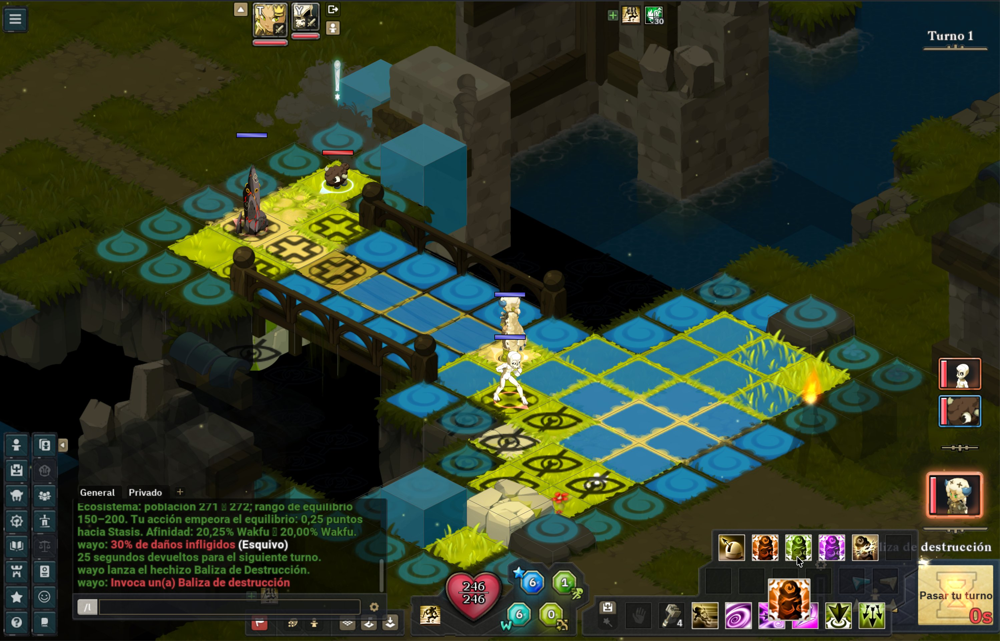
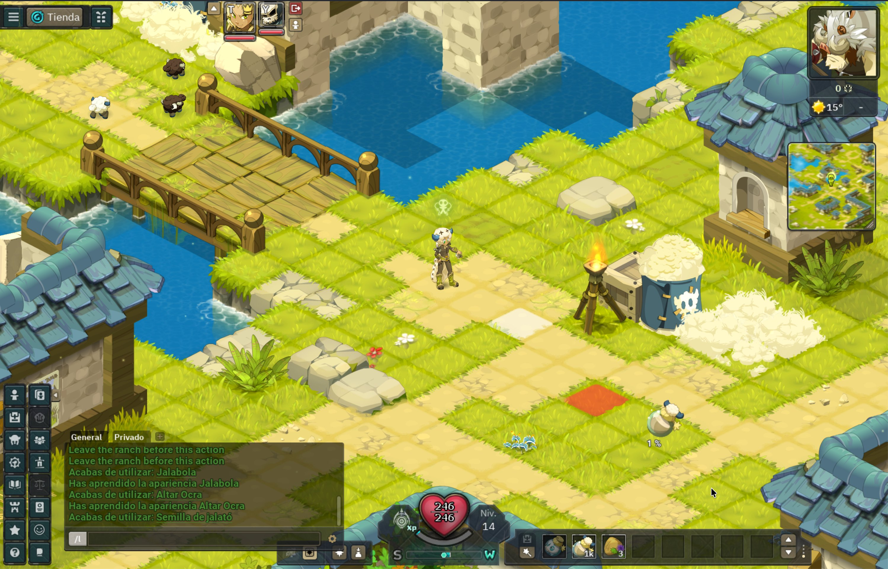
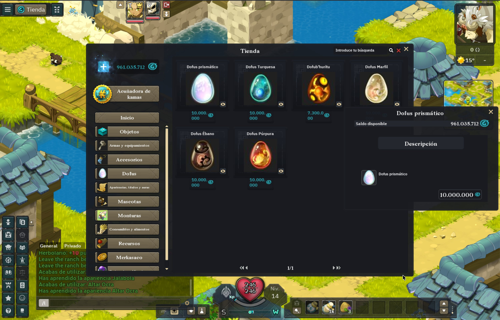

# Wakemu — a Wakfu experiment

A personal experiment in understanding game protocols and building a Python server emulator. This is a work in progress; implemented systems have varying levels of coverage and testing.

## Features

- **Accounts and characters:** local login, character creation, saved progression, and multiple client profiles.
- **World exploration:** map movement, interactive objects, and transport between supported locations.
- **Turn-based combat:** placement, movement, spells, states, summons, and monster AI.
- **Multiplayer:** player groups, trading, joining fights, and combat spectating.
- **Inventory and builds:** bags, equipment, spell decks, and saved build selection.
- **Professions:** harvesting, planting, crafting, and profession experience.
- **Ecology:** plant growth, monster maturation and reproduction, and Wakfu/Stasis progression.
- **Progression and rewards:** combat experience, leveling, and supported loot and currency rules.
- **Local administration:** a web panel for accounts, maps, sessions, settings, and shop catalogs.
- **Developer tools:** protocol inspection, client diagnostics, automated tests, and Docker services.

## Screenshots

**Combat with heroes**

<a href="screenshots/combatwithheroes.jpg"></a>

**Planting**

<a href="screenshots/planting.jpg"></a>

**Shop**

<a href="screenshots/shop.jpg"></a>

## What's missing

- **Combat coverage:** validate all classes, spells, summons, and monster mechanics through complete gameplay tests.
- **Dungeons and rewards:** finish compatibility and verify encounter rules, difficulty, drops, and currency end to end.
- **NPCs and quests:** expand playable dialogue, story progression, and quest rewards beyond supported interactions.
- **Social features:** finish validation of duels, private messaging, and specialized chat channels.
- **Performance and reliability:** reduce combat latency and resolve remaining synchronization and client presentation issues.
- **Fresh-clone setup:** replace private capture dependencies and automate the remaining runtime preparation.
- **Broader compatibility:** extend supported content; only client version 1.93.1+79 is currently targeted.

Developers and testers are welcome—report reproducible bugs, contribute fixes, or help make a fresh clone easier to run.

For more information, explore the [documentation](docs/README.md): follow the [setup guide](docs/getting-started.md), learn about the [architecture](docs/architecture.md), [protocol and server internals](docs/protocol/README.md), [combat and AI](docs/combat-and-ai.md), [world and ecology](docs/world-and-ecology.md), and [characters and items](docs/characters-and-items.md), or read about [administration](docs/administration.md), [known limitations](docs/limitations.md), and [contributing](docs/contributing.md).

## Run locally

Requires Docker Compose, Git LFS, Python 3 with Tk, JDK 21+, and macOS or Linux with a graphical session.

1. Supply your own lawfully obtained **Wakfu 1.93.1+79** client in `client/`, with `config.properties`, `classpath`, `contents/`, `lib/`, and `jre/` directly inside it. Other versions are unsupported.
2. **Setup is not yet self-contained:** world requires catalogs and verified bootstrap records in PostgreSQL, plus matching private credentials at the configured service mounts. Follow the [setup prerequisites](docs/getting-started.md#current-setup-requirements) and [database guide](database/README.md) before starting. Runtime preparation alone does not supply all inputs.
3. From the repository root:

   ```sh
   git lfs pull
   python3 tools/prepare-local-runtime.py
   bash tools/build-local.sh
   docker compose up -d --build
   docker compose ps
   bash client-tools/client.sh play
   ```

The launcher requests local login when needed. See [client tools](client-tools/README.md) for launcher options and additional profiles. Inspect failures with `docker compose logs -f world`.

## Client and third-party material

This is an independent educational experiment, unaffiliated with Ankama. I have no interest in distributing the official client or its assets; users must supply their own copy. The entire `client/`, private `.database/`, and generated `.runtime/` directories are excluded through [`.gitignore`](.gitignore). Wakfu and related marks belong to their respective owners.

My goal is to learn and experiment, with respect for Ankama's work and intellectual property—not to infringe anyone's rights or compete with the official game. If a rights holder has concerns, please open an issue so I can address them promptly. Please contribute original code and synthetic tests; do not submit client binaries or game assets.
